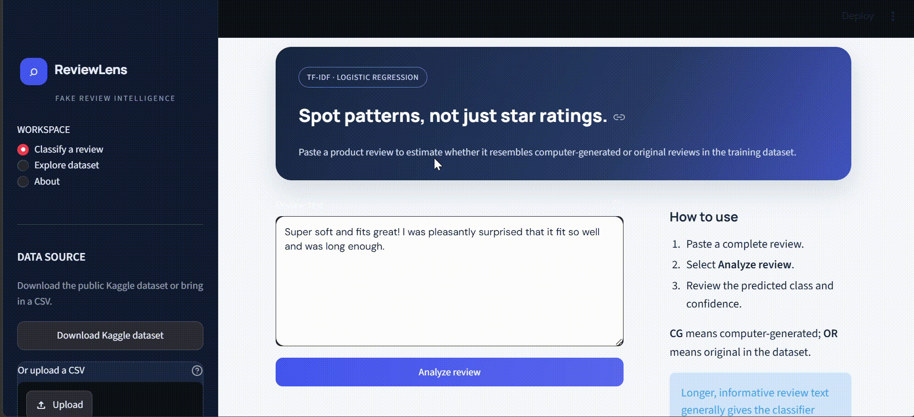

# Fake Reviews Detection Using NLP and Machine Learning
---

---
## 📌 Project Overview

The **Fake Reviews Detection** project uses Natural Language Processing (NLP) and Machine Learning to classify product reviews as computer-generated or genuine. The project analyzes review text, processes the language, converts text into numerical features, and trains a Logistic Regression model to predict the review category.

This project demonstrates how NLP techniques can help identify potentially fake reviews and support more reliable online shopping experiences.

## 🎯 Objectives

- Analyze and classify fake and genuine product reviews.
- Clean and preprocess raw review text.
- Explore the dataset using data visualization.
- Convert text into numerical features using TF-IDF.
- Train a Logistic Regression classification model.
- Evaluate model performance using classification metrics and ROC-AUC.
- Save and load the trained model for future predictions.

## 📂 Dataset Information

**Dataset:** Fake Reviews Dataset  
**Source:** Kaggle — [mexwell/fake-reviews-dataset](https://www.kaggle.com/datasets/mexwell/fake-reviews-dataset)

The dataset contains approximately 40,432 review records before duplicate removal.

Important columns used in the project include:

| Column | Description |
|---|---|
| `category` | Product category |
| `rating` | Product review rating |
| `label` | Review class: CG or OR |
| `text_` | Original review text |

**Target labels:**
- `CG` — Computer-Generated review
- `OR` — Original or genuine review

The notebook also adjusts the class distribution to approximately 60% and 40% for experimentation.

## 🛠️ Technologies Used

- Python
- Pandas and NumPy
- Matplotlib and Seaborn
- NLTK
- Scikit-learn
- KaggleHub
- Joblib
- Jupyter Notebook

## 🔄 Project Workflow

### 1. Dataset Collection and Exploration
- Download the dataset using KaggleHub.
- Load the CSV file using Pandas.
- Check dataset information, missing values, and duplicate records.

### 2. Data Visualization
- Plot the distribution of fake and genuine reviews.
- Visualize label percentages.
- Analyze review counts across product categories.

### 3. Text Preprocessing
The following NLP techniques are applied to the review text:

- Convert text to lowercase.
- Remove HTML tags and URLs.
- Remove punctuation and numerical values.
- Remove extra whitespace.
- Tokenize text into individual words.
- Remove English stopwords.
- Apply lemmatization using NLTK.

### 4. Label Encoding
The target labels are converted into numerical values using Scikit-learn's `LabelEncoder`.

### 5. Feature Extraction
TF-IDF (Term Frequency–Inverse Document Frequency) converts the processed reviews into numerical features.

The vectorizer uses:
- `max_features=10000`
- `ngram_range=(1, 2)`
- `min_df=2`
- `max_df=0.95`

### 6. Model Training
Logistic Regression is trained on the TF-IDF features.

The dataset is split into:
- 80% training data
- 20% testing data

Stratified splitting is used to preserve the class proportions in both sets.

### 7. Model Evaluation
The model is evaluated using:

- Accuracy Score
- Precision
- Recall
- F1-Score
- Classification Report
- ROC Curve
- ROC-AUC Score

The ROC curve helps assess how effectively the model distinguishes between the two classes at different classification thresholds.

### 8. Model Saving and Loading
The trained model, TF-IDF vectorizer, and label encoder are saved together in a Joblib file named `nlp_model_bundle.joblib`.

The saved bundle can be loaded later to transform new review text and generate predictions without retraining the model.

## ⚙️ Installation

Install the required libraries:

```bash
pip install pandas numpy matplotlib seaborn nltk scikit-learn kagglehub joblib jupyter
```

## ▶️ How to Run the Project

1. Clone or download this repository.
2. Open the project folder.
3. Install the required dependencies.
4. Launch Jupyter Notebook:

```bash
jupyter notebook
```

5. Open `Fake_Reviews_Dataset.ipynb`.
6. Run the notebook cells sequentially.

KaggleHub may require appropriate Kaggle access or authentication to download the dataset.

## 💾 Saved Model

The notebook saves the model bundle using:

```python
joblib.dump(model_bundle, "nlp_model_bundle.joblib")
```

The bundle contains:

- `model` — Trained Logistic Regression model
- `tfidf` — Fitted TF-IDF vectorizer
- `label_encoder` — Fitted target label encoder

Keep the saved file in the appropriate project directory when using it for predictions.

## 🔍 Example Prediction

The notebook demonstrates how to predict the category of a new review:

```python
text = ["This product is excellent and works as expected."]

text_tfidf = tfidf.transform(text)
prediction = lr_model.predict(text_tfidf)

predicted_label = label_encoder.inverse_transform(
    prediction.astype(int)
)

print("Predicted Label:", predicted_label[0])
```

The output is either `CG` or `OR`, depending on the model's prediction.

## 📊 Results

The notebook calculates accuracy, classification metrics, and ROC-AUC on the test set. The actual numerical results depend on the dataset and training run.

The model's performance should be evaluated using the printed metrics rather than assuming a particular accuracy in advance.

## 🚀 Future Improvements

- Compare Logistic Regression with Multinomial Naive Bayes, Linear SVM, and Random Forest.
- Experiment with different text preprocessing methods.
- Analyze model performance on different product categories.
- Build a Streamlit web application for interactive predictions.
- Evaluate the model on unseen reviews to assess generalization.

## 📌 Conclusion

This project demonstrates a complete NLP classification workflow, from dataset collection and text preprocessing to feature extraction, model training, evaluation, and model persistence. It provides practical experience with NLP and machine learning for identifying computer-generated and genuine product reviews.

## 👨‍💻 Author

**Hemant Singh**

BCA | Machine Learning and Natural Language Processing

---

*Disclaimer: This project is intended for educational purposes. Predictions are based on patterns learned from the training dataset and should not be treated as definitive proof that a review is fake or genuine.*
